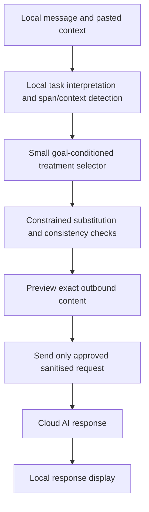

# Mask: local privacy middleware for AI conversations

**Priority update:** [LOCAL_MODEL_PLAN.md](LOCAL_MODEL_PLAN.md) now governs execution. Build the English local model and message/CSV/XLSX adapters primarily on this computer before further UI or cloud-provider integration. This document remains consumer product background; its three-computer split, small demo dataset and demo-first sequence are superseded by the model plan's training and release criteria.

Updated 7 November 2026. This is the current product direction and hackathon delivery plan. It supersedes institutional dataset sharing as the primary demonstration. Preserve the existing implementation and benchmark artifacts; adapt them rather than rebuild. Requirements below are proposed work, not implemented capabilities.

## Outcome and scope

**Mask lets people get useful help from a cloud AI while sharing less unnecessary personal information.** A small local model chooses how to transform individual details, and a constrained executor preserves task-critical meaning. “Nano” is a size/latency objective to measure, not an existing model capability claim.

Build a convincing hackathon prototype, not a production browser extension or universal consumer service. One concrete scenario is sufficient: a person asks an external AI to explain a synthetic health-related note in plain language and help formulate questions for a clinician. The sharing scenario is the consumer sending selected context to a cloud AI. The demo does not provide diagnosis or treatment recommendations and does not need real health records.

Retain the white minimalist interface, typography, divider, highlighter explanations and developer details. Make conversation/pasted context the main input. Keep CSV tools as a secondary engineering/evaluation mode. Show one working provider integration through our own composer; transparent interception of third-party chat websites, PDF/OCR, voice, mobile, and broad domain coverage are stretch work.

## Verified starting point

Inspection at commit `de10585` found the browser pipeline, TypeScript contracts, worker, detectors, executors, learned-selector loader and benchmark adapter. This was source/artifact inspection, not a fresh browser acceptance test or test-suite rerun.

| Existing asset | Assessment for this pivot |
|---|---|
| CSV import → proposal → preview/edit → exact export | Reuse session/version handling, review controls and evidence receipts; add a text/message adapter |
| Column and 20-label span detectors | Reuse baseline; reported cross-domain HEALTH/LOCATION/ORG weakness needs targeted prompt tests |
| Rules plus learned recipe ranking | Reuse interface/trainer; old decision units and targets do not establish prompt-task performance |
| 882 annotations | `ml/labels/SUMMARY.json`: all train, 828 challenger agreements and 54 disagreements; agreement is not independent validation |
| Loaded `selector-dev.json` | Linear model, hashed-bag-of-words goal features, 2,445 examples including variants, zero validation/test examples; no calibration or held-out performance |
| Full-size CS-S1 benchmark artifacts | Policy, leaky and destructive reports exist; policy reports one leaked USERNAME span and other limitations. These are institutional table/text results, not consumer-prompt validation |
| Current recipe implementation | Realistic surrogates include invented identities/locations and changes to ages/dates; this is not yet faithful semantic substitution |
| Current hard masks | External HEALTH spans cannot be kept. That institutional rule conflicts with a consumer intentionally asking a health question |

Some existing README status paragraphs are stale. Preserve original run provenance; do not relabel old evidence as results for the pivot. Benchmark rows tagged test do not establish end-to-end blindness if detector lexicons or policy changes were informed by the same domain.

## Product architecture

Implement an owned composer in Mask first. Raw prompts, local aliases and unsent conversation history stay in the browser. If a credential-holding relay is needed, it receives only the sanitised request; never put provider secrets in the client bundle. Remote goal interpretation or embeddings must not receive the raw message before protection. A Gemini goal parser is therefore not a dependency for this slice.

Use an explicit `consumer_prompt_v1` mode and new contract/model versions. Keep existing institutional masks intact. Allow the user to intentionally share task-essential sensitive facts, display what remains sensitive, and continue blocking unnecessary direct identifiers/secrets under this demo policy. Do not equate choosing a health task with blanket permission to forward all health content.

The provider still receives retained facts and ordinary connection/account metadata. The claim is reduced unnecessary disclosure, not anonymous access, zero health-data disclosure, or a change to provider storage practices.

## Faithful semantic substitution

Predict treatment for individual spans or linked groups in their sentence and conversation context. The old `span_class` choice applies one treatment to all spans of a label; it cannot distinguish an irrelevant birth date from a date interval needed by the question. Do not just wrap a whole prompt in a one-row CSV and keep that limitation silently.

| Treatment | Example and condition |
|---|---|
| Keep exact | Task-required measurement, unit, medication term, negation or timing remains exact |
| Drop irrelevant detail | Omit an unrelated email, address or account identifier |
| Role substitution | A named clinician becomes “my clinician” when the relationship is explicit |
| Stable alias | Two distinct people become “Person A” and “Person B,” consistent within the conversation |
| Faithful generalisation | Reduce date/location precision only when the task does not require the finer detail |
| Typed placeholder | Use an honest placeholder when abstraction would add assumptions |
| Needs review | Unclear relevance, unsupported form or conflicting constraints stops automatic sending |

Never replace a health fact with a different plausible fact. Protect numerical values, units, negation, chronology, relations and uncertainty where they carry task meaning. Do not infer a role not stated in the source. For the demo, disable random realistic replacements for age, dates, geography and clinical content. Role labels and aliases are preferred over invented realistic identities.

Keep aliases stable and collision-free within a conversation, scoped locally, with a reset control. Do not merge two people because they share a first name. Automatic restoration of names in generated answers is optional; naive string replacement can misattribute people and is not necessary for the demo.

Use constrained edits with exact spans and deterministic replacements first. A local generative rewriter is optional only if evaluated against this baseline. General text similarity does not prove preservation of clinically meaningful facts.

## Model and training change

Keep softmax over valid treatment candidates and categorical cross-entropy. Inputs now need the span, surrounding sentence, role/relations, local task and relevant conversation context. Use a small classifier over contextual features or a compact local encoder, rather than assuming the existing 256-dimensional hashed bag-of-words representation understands semantics. Profile any encoder on actual demo hardware before adopting it.

Train the prompt selector on a separately versioned dataset/feature registry, provisionally `mask/ml/prompt_v1/`. Do not overwrite the frozen institutional `ml/SPLITS.json` or pool old test material into training. Preserve the old model as a baseline. Only reuse old annotations that actually match the new action semantics, with explicit provenance and review.

Start with approximately 150–250 synthetic prompt/conversation cases if time permits. Group by underlying persona, source document, task template and all derived paraphrases before assigning roughly 60/20/20 train/validation/test proportions. Raw case counts are not independent sample counts; report both. Use fresh source families for the final test rather than rewritten versions of development examples or the public demo script. This is a small hackathon evaluation, not broad consumer validation.

Annotation records should contain: task, original synthetic message/context, exact sensitive-span offsets, task-essential fact checklist, treatment/acceptable alternatives, approved transformed text, protected relations/numbers, uncertainty, and provenance. Include same-category/different-relevance examples and multi-turn follow-ups. Large agents can propose labels, a fresh reviewer can challenge them, and humans audit stratified examples and all factual disagreements. Agent agreement alone is weak supervision. Prefer training on approved transformations over general “safe/unsafe” opinions.

Complete validation and a human-audited frozen test before reporting learned-model superiority. Calibrate only on validation data. If the learned selector fails to improve over the deterministic baseline, use the stronger baseline in the demonstration and show training as an experiment with its actual limits. Do not call the current unvalidated institutional model a high-precision prompt model.

CPU training is sufficient for the existing linear head. Teammate cloud resources are useful for approved synthetic annotation batches, embeddings or compact-model experiments; acquiring or scaling infrastructure is not on the critical path. Record model bytes, feature/encoder size, peak memory, device and measured cold/warm p50/p95 latency, including preprocessing. A small head plus a large encoder is not a tiny end-to-end system.

## Evaluation for the new claim

The three main arms are original prompt, fixed typed-placeholder masking, and Mask's task-aware treatment. Add an aggressive-removal control and a goal-agnostic selector ablation. Run all arms against the same external model/version/settings and fixed task rubric on synthetic material. Record actual requests and responses; cache demo responses with honest replay labels when necessary. A useful original answer is a reference, not automatically correct ground truth.

Measure separately:

- **Unnecessary disclosure:** retained annotated identifying/nonessential sensitive facts; per-category recall/precision; explicit residual sensitive content that is essential to the task.
- **Meaning fidelity:** exact preservation of required facts, quantities, units, negation, relations and timing; introduced facts or omissions. Audit the final answer too, without crediting downstream hallucinations as successful preservation.
- **Task utility:** independently reviewed task-specific answer rubric, with blind arm comparison where feasible. LLM judges may assist but cannot be the sole correctness authority.
- **Contextual attacks:** identity/attribute inference from remaining combinations using a stated synthetic attacker background. Match correct identity or inference against ground truth; count unsupported threats honestly. A single guessed name or refusal is not a measured attack outcome.
- **Conversation behaviour:** consistent aliases, later-turn accumulation, corrections, task changes and old sensitive history not being silently resent. Evaluate the full transmitted transcript, not only the latest turn.
- **Transport boundary:** inspect outbound requests on synthetic canary cases; assert raw markers, local mappings, originals, debug logs and old unsanitised history never appear in outgoing payloads. Verify cancellation/stale-response handling and content-approval hashes.
- **Latency/coverage:** cold/warm preprocessing and selector latency, automatic-send coverage, review rate and failures on named demo hardware. Separate these from provider response latency.

Reuse `pets-eval` span leakage and existing infrastructure as regression evidence where the representation is compatible. Retain CS-S1 reports as development history. The table benchmark does not measure prompt meaning or downstream answer quality. Add a prompt evaluator rather than inventing CS-S2/CS-S3 equivalence. Record any adaptation and never compare incomparable composite scores.

Fix or conservatively handle the known USERNAME gap on prompt-relevant regression cases. The institutional k-anonymity failure remains documented, but optimising table k is not the new demo gate; prompt re-identification and conversational leakage are different threats. Do not improve apparent scores by calling untested attacks safe.

Before training, agree the rubric and thresholds on development data. Suggested release gate for the finite demo suite: no task-critical factual edits or identifier/secret canary escapes; unresolved cases require review. Report counts and denominators, including failures. Passing that finite suite is not a universal guarantee.

## UI and live demonstration

Use the current visual design. Left: the conversation and request. Right: pasted synthetic context, exact outbound preview and brief “changed / retained / why” details. Show the cloud answer after sending. The normal send flow performs the local pass; review is expandable for validated examples and mandatory for ambiguous changes. During the hackathon, explicitly display the outbound request so judges can see the boundary.

Demonstration sequence:

1. Paste a synthetic note containing identifying detail and task-relevant facts. Ask for a plain-language explanation and questions to ask a clinician.
2. Show why blanket masking removes useful context, using actual measured outputs, not a deliberately broken straw-man baseline.
3. Show Mask's precise changes and preserved facts. Send the exact protected request to one real cloud model and display its actual answer.
4. Ask a follow-up and show alias/context consistency. Demonstrate one uncertain case that asks for review rather than silently changing meaning.
5. Open developer details: detected types, selected treatments, outbound-content evidence, measured privacy/fidelity/utility and latency, and limitations.

Use one scenario and a small rehearsed sequence. A live request is ideal; label a cached run as recorded if connectivity fails. The organisers' five elements remain visible: identified risks, PET choices/reasons, protected output, measured privacy/utility, and a defined sharing scenario with limitations.

## What changes in Claude's remaining work

| Previous item | New priority |
|---|---|
| Annotate all Team B and customer-service recipe tasks | Defer broad completion; redirect effort to prompt-context labels and human audit |
| CS-S2/CS-S3 candidate benchmarks | Optional legacy work; not required for the consumer demonstration |
| Train on all old labels | Preserve baseline; train/evaluate the new prompt task separately |
| Pasted-context feature | P0: actual message/context input and task-aware span decisions, not only a detector-confidence nudge |
| Known leaked USERNAME | P0 targeted detection/fallback regression; keep historical failure visible |
| Weak table k-anonymity | Retain limitation; not a substitute for prompt-risk evaluation |
| Gemini goal interpreter | Defer raw-prompt cloud interpretation; protect locally before external calls |
| Model-based NER | Targeted P1 where prompt tests expose gaps; avoid unbounded domain expansion |
| More design refinement | Preserve current design; focus effort on clear outbound preview and send loop |

## Next steps and owners

| Priority | Owner | Concrete deliverable / exit condition |
|---|---|---|
| P0.1 | Lead + all owners | Freeze consumer mode, action semantics, prompt contracts and one synthetic demo script; preserve current app |
| P0.2 | Computer 2: local pipeline | Individual-span/message adapter, factual invariants, alias scope, history handling, sanitised transport payload; deterministic end-to-end path |
| P0.3 | Computer 1: UX/integration | Reuse existing panes; paste → protect → inspect → send → real response; stale approval rejected |
| P0.4 | Computer 3: ML/evaluation | Freeze new grouped split and gold rubrics; create/audit prompt labels; baseline and three-arm evaluation harness |
| P1.1 | ML owner / teammate cloud | Train compact prompt selector, compare on held-out cases and benchmark local latency; no forced model claim |
| P1.2 | Pipeline + evaluation | Fix demonstrated leakage/fidelity issues on development cases; preserve frozen test; regression controls and outbound-request checks |
| P1.3 | Lead | Rehearse one real demonstration, collect portable evidence, report achieved/missed targets and limitations |
| Stretch | Available capacity | One supported browser integration, additional languages/domains, PDF input or safe local name restoration |

Parallelise against a small shared contract: `PromptSession`, `TaskSpec`, `SpanDecision`, `ProtectedRequest`, `PromptEvaluation`, and `SendReceipt`. Include source offsets, conversation/entity IDs, original/goal/plan versions, selected valid treatments, required-fact checks and exact outbound hash. Original values/maps belong only to local state. Version API/feature/recipe artifacts together; reject incompatible legacy models explicitly.

Finish P0 without waiting for new model training. Do not expose a fake learned path or fake cloud response. The strongest hackathon claim is a demonstrated reduction in unnecessary disclosure while preserving task usefulness, supported by actual measurements and a polished interaction—not infrastructure scale or a production-readiness promise.

## Sources

- [Challenge and evaluation sources](../MATERIALS.md)
- [Current implementation](../mask/README.md), [ML pipeline](../mask/ml/README.md), [feature definition](../mask/ml/FEATURES.md), [benchmark adapter](../mask/bench/README.md)
- Prior art for comparison, not evidence for Mask: [Casper](https://arxiv.org/abs/2408.07004), [Need to Know](https://arxiv.org/abs/2606.04067).
